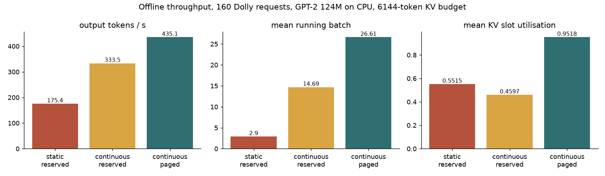
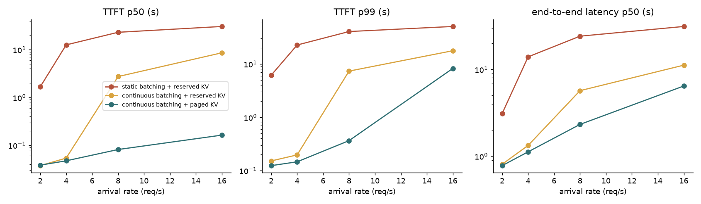
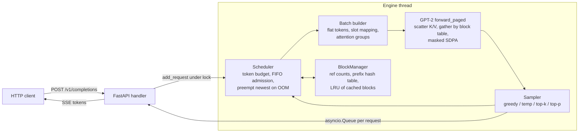

# paged-inference-engine

A small LLM inference engine written from scratch in PyTorch. It implements the core ideas behind modern serving systems and measures each one separately against a baseline:

- **Paged KV cache.** Keys and values live in fixed-size blocks, allocated on demand through per-sequence block tables, with reference counting.
- **Continuous (iteration-level) batching.** The batch is re-planned every step.
- **Chunked prefill.** A per-step token budget; decodes are scheduled first.
- **Recompute preemption.** When KV memory runs out, the newest sequence gives up its blocks.
- **Prefix caching.** Full blocks are keyed by chained hashes, with an LRU of evictable blocks.
- **An OpenAI-style HTTP API.** SSE token streaming and Prometheus metrics.

The model is GPT-2 (124M), loaded from the Hugging Face Hub and reimplemented here. Its greedy output matches Hugging Face `transformers` token for token on 24 of 24 Dolly prompts.

## Key results

Workload: 160 requests from [databricks-dolly-15k](https://huggingface.co/datasets/databricks/databricks-dolly-15k) (CC BY-SA 3.0), using real prompt lengths (mean 75.2 tokens) and real response lengths (mean 68.9 tokens). Every request sends `max_tokens = 256`. The KV budget is 384 blocks x 16 tokens = 6,144 token slots (432 MiB). The model is GPT-2 124M in float32 on an Apple M-series laptop CPU with 4 torch threads. All three systems share the same model code; only the scheduling policy and the memory policy differ.

**Offline (all 160 requests at t = 0)**, from `reports/offline_throughput.json`:

| System | Output tok/s | Makespan (s) | TTFT p50 (s) | E2E p99 (s) | Mean batch | KV slot utilisation |
|---|---:|---:|---:|---:|---:|---:|
| Static batching + reserved KV | 175.4 | 62.889 | 35.3983 | 62.76 | 2.9 | 0.5515 |
| Continuous batching + reserved KV | 333.5 | 33.069 | 14.2737 | 32.632 | 14.69 | 0.4597 |
| Continuous batching + paged KV | **435.1** | **25.349** | **3.3673** | **24.746** | **26.61** | **0.9518** |

Compared with static batching, continuous batching gives 1.90x the throughput. Adding the paged KV cache brings that to 2.48x, because nearly twice as many sequences fit in the same memory. Paging has a cost: the paged run preempted 57 times and recomputed prefill work (16,342 prefill tokens computed vs 12,024), and its per-token decode time is higher (TPOT 100.65 ms vs 49.35 ms) because each step runs a bigger batch.

**Online (Poisson arrivals)**, from `reports/online_latency.json`, TTFT p50 / p99 in seconds:

| Arrival rate | Static + reserved | Continuous + reserved | Continuous + paged |
|---|---|---|---|
| 2 req/s | 1.6669 / 6.1615 | 0.0375 / 0.1518 | 0.0384 / 0.1239 |
| 4 req/s | 12.5986 / 22.7117 | 0.0539 / 0.197 | 0.0473 / 0.1462 |
| 8 req/s | 23.1205 / 40.6514 | 2.738 / 7.3576 | 0.0815 / 0.3647 |
| 16 req/s | 30.6082 / 50.6211 | 8.6105 / 17.7553 | 0.1631 / 8.2696 |

**Prefix caching**, from `reports/prefix_caching.json`: 96 requests share a 424-token 8-shot prefix and arrive at 8 req/s.

| | Prefill tokens computed | TTFT p50 (s) | TTFT p99 (s) | E2E p50 (s) | Block hit rate |
|---|---:|---:|---:|---:|---:|
| No prefix cache | 41,854 | 0.9817 | 2.4614 | 3.036 | 0 |
| Prefix cache | 2,318 | 0.0409 | 0.0651 | 0.853 | 0.9446 |

**Memory waste at completion**, from `reports/fragmentation.json` (exact, over the 160 requests):

| Allocation | Slots allocated | Waste |
|---|---:|---:|
| Reserve prompt + max_tokens | 52,984 | 56.49% |
| Paged, block 8 | 23,600 | 2.32% |
| Paged, block 16 | 24,192 | 4.71% |
| Paged, block 32 | 25,632 | 10.06% |
| Paged, block 64 | 28,288 | 18.51% |

**Block size sweep** (offline, same memory), from `reports/block_size_sweep.json`: block size 8 / 16 / 32 / 64 gave 443.8 / 437.1 / 436.5 / 426.4 tok/s, with KV utilisation of 0.9749 / 0.9518 / 0.9084 / 0.8315.

**Batch scaling** (why any of this matters), from `reports/batch_scaling.json`: decode throughput is 127.9 tok/s at batch 1, 385.8 at batch 8, 927.5 at batch 32 and 1,083.9 at batch 64.

**Correctness**, from `reports/parity.json`: greedy generation (up to 64 tokens, batched, paged, chunked) matches `transformers` exactly on 24 of 24 prompts.




## Architecture



```
KV pool per layer: k[num_blocks, block_size, heads, head_dim]   (and v)
seq A block_table = [7, 2, 9]   tokens 0-15 -> block 7, 16-31 -> block 2, 32.. -> block 9
seq B block_table = [7, 4]      same first 16 tokens as A: shares block 7 (ref_count 2)
slot(token i) = block_table[i // block_size] * block_size + i % block_size
```

## How it works

1. **Scheduling.** Each step has a token budget (512 by default). Running sequences go first: a decode costs one token, and a sequence still in prefill gets a chunk of the remaining budget. If a sequence needs a new block and none is free, the newest running sequence is preempted: its blocks are freed, and it is re-queued at the front and recomputed later. Leftover budget admits waiting requests in FIFO order. With `policy="static"`, new requests are admitted only after the whole previous batch has finished.
2. **Batch construction.** The new tokens of all scheduled sequences are flattened into one `[T]` tensor, so the QKV, output projection and MLP run as single matmuls with no padding. For attention, sequences are grouped into decodes (1 query) and prefill chunks (many queries), and each group is padded only to its own longest query.
3. **Paged attention.** In every layer, new K/V are written to their slots. Each sequence's context is gathered through its block table, and a mask `key_pos <= query_pos and key_pos < context_len` is applied. Prefill, chunked prefill, recompute and decode all use this one path.
4. **Prefix caching.** When a block fills, it is registered under `hash(prev_hash, tokens)`. A new request reuses cached blocks while its hashes match. The last prompt token is always recomputed, since its logits are needed. Blocks whose reference count reaches zero stay cached in an LRU until the memory is needed.
5. **Serving.** A single background thread owns the engine. HTTP handlers enqueue requests and read tokens from per-request `asyncio.Queue`s.

The baseline systems are configurations of the same engine (`policy="static"`, `reserve_max=True`), so the comparisons isolate scheduling and memory management. Requests replay their real Dolly response length as an early stop (`stop_after`), while `max_tokens = 256` stays the cap a reserving allocator must plan for, just as a real server never knows output length in advance.

## Tech stack

Python 3.11, PyTorch (model and attention via `scaled_dot_product_attention`), safetensors, Hugging Face `tokenizers` and `huggingface_hub` (weights and tokenizer download), FastAPI and Uvicorn (API), NumPy and Matplotlib (benchmarks), pytest, GitHub Actions and Docker.

## Setup

```bash
uv venv --python 3.11 .venv && source .venv/bin/activate
uv pip install -r requirements-dev.txt     # or: pip install -r requirements-dev.txt
```

GPT-2 weights (548 MB, MIT license) and the tokenizer are downloaded from the Hugging Face Hub on first use and cached under `~/.cache/huggingface`. No API keys are required. Setting `HF_TOKEN` only raises download rate limits.

## Run

```bash
# offline generation
python -m pagedserve generate "The capital of France is" "def fibonacci(n):" --max-tokens 40

# API server (add --prefix-caching, --policy static, --reserve-max to compare)
python -m pagedserve serve --port 8000
curl -s localhost:8000/v1/completions -H 'content-type: application/json' \
     -d '{"prompt": "Once upon a time", "max_tokens": 30}'
curl -N localhost:8000/v1/completions -H 'content-type: application/json' \
     -d '{"prompt": "Once upon a time", "max_tokens": 30, "stream": true}'
curl -s localhost:8000/metrics

# Docker
docker build -t pagedserve . && docker run -p 8000:8000 pagedserve
```

## Test and benchmark

```bash
pytest -q                                   # 32 tests on a tiny random-weight GPT-2, no downloads
PAGEDSERVE_HF_TESTS=1 pytest -q tests/test_hf_parity.py   # real GPT-2 vs transformers (2 tests)
python -m bench.run_benchmarks              # writes reports/*.json and charts (~15 min on a laptop CPU)
python -m bench.parity                      # reports/parity.json
python -m bench.batch_scaling               # reports/batch_scaling.json
```

The core engine tests check that the paged engine's greedy output equals a cache-free dense reference, token for token, under seven configurations:

- block sizes 1, 3 and 16
- chunked prefill with a 7-token budget
- static and continuous scheduling
- reserved and lazy allocation
- prefix caching
- a memory budget small enough to force preemption

## Project structure

```
pagedserve/
  config.py          ModelConfig, EngineConfig
  sequence.py        SamplingParams, Sequence state
  block_manager.py   block allocator, block tables, prefix cache
  scheduler.py       continuous/static policies, chunked prefill, preemption
  model.py           GPT-2 with paged attention + dense reference, weight loader
  engine.py          step loop, batch construction, stats
  sampler.py         greedy / temperature / top-k / top-p, per-request RNG
  server.py          FastAPI completions API, SSE streaming, /metrics
  tokenizer.py       GPT-2 BPE and byte tokenizers
  cli.py             generate / serve commands
bench/
  workload.py        Dolly-15k request builder (downloaded at runtime)
  harness.py         Poisson replay and latency metrics
  run_benchmarks.py  all experiments -> reports/
  parity.py          comparison with transformers
  batch_scaling.py   throughput vs batch size
  plots.py           charts
tests/               unit, integration, API and opt-in parity tests
reports/             saved benchmark results (JSON + PNG)
```

## Limitations

- **CPU, float32, GPT-2 only.** Absolute throughput is far below a GPU server. The relative comparisons are the point.
- **No custom kernel.** Attention gathers blocks into a contiguous tensor before calling SDPA. A real PagedAttention kernel reads blocks in place and avoids that copy.
- **Simple preemption.** Preemption is recompute-only (no swapping to host memory), and admission reserves the whole prompt rather than one chunk at a time.
- **No beam search or parallel sampling,** so there are no copy-on-write blocks. Prefix caching matches only whole blocks.
- **Single process.** One engine thread; tokenisation and detokenisation run in the request handlers.
- **Noisy timings.** Results come from one run per configuration on a laptop, so wall-clock numbers vary from run to run.

## License

MIT. GPT-2 weights: MIT (OpenAI). Dolly-15k: CC BY-SA 3.0 (Databricks); the dataset is downloaded at runtime and not redistributed.
